<picture>
  <source media="(prefers-color-scheme: dark)" srcset="./assets/hero-dark.svg">
  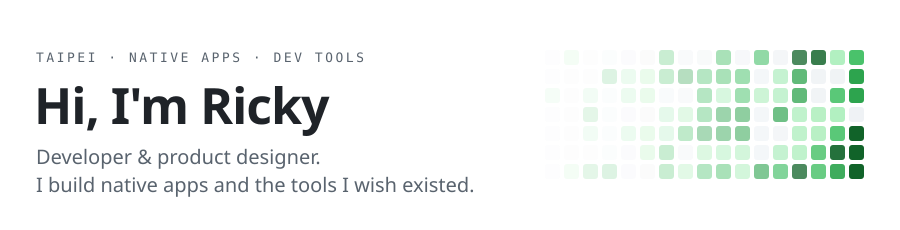
</picture>

### On the App Store

<table>
  <tr>
    <td align="center" valign="top" width="33%">
      <a href="https://apps.apple.com/app/%E6%9B%B8%E6%88%BF/id6798525550"></a><br>
      <b><a href="https://apps.apple.com/app/%E6%9B%B8%E6%88%BF/id6798525550">書房</a></b><br>
      <sub>Ad-free novel, comic &amp; RSS reader. Paste a URL, read offline. No account, no tracking · <a href="https://shufang-reader.pages.dev/">Website</a></sub>
    </td>
    <td align="center" valign="top" width="33%">
      <a href="https://apps.apple.com/tw/app/simple-cf/id6785373007"></a><br>
      <b><a href="https://apps.apple.com/tw/app/simple-cf/id6785373007">Simple CF</a></b><br>
      <sub>Fast, native iOS &amp; iPadOS client for your Cloudflare account</sub>
    </td>
    <td align="center" valign="top" width="33%">
      <a href="https://apps.apple.com/app/ambientsound/id6792389273">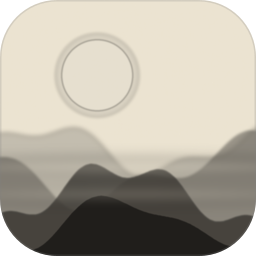</a><br>
      <b><a href="https://apps.apple.com/app/ambientsound/id6792389273">AmbientSound</a></b><br>
      <sub>Ink-wash styled white noise &amp; sleep app. Play and mix ambient sounds</sub>
    </td>
  </tr>
  <tr>
    <td align="center" valign="top" width="33%">
      <a href="https://apps.apple.com/app/minigames/id6795174941"></a><br>
      <b><a href="https://apps.apple.com/app/minigames/id6795174941">MiniGames</a></b><br>
      <sub>Four childhood arcade games, redesigned for touch</sub>
    </td>
    <td align="center" valign="top" width="33%">
      <a href="https://apps.apple.com/app/ringtone-cutter/id6823386594"></a><br>
      <b><a href="https://apps.apple.com/app/ringtone-cutter/id6823386594">Ringtone Cutter</a></b><br>
      <sub>Trim any song into an iPhone ringtone. Waveform editor, fades, one-tap “Use as Ringtone”</sub>
    </td>
    <td align="center" valign="top" width="33%">
      <a href="https://apps.apple.com/app/%E5%B0%8F%E6%98%9F%E6%98%9F%E5%A1%97%E8%89%B2/id6823662245"></a><br>
      <b><a href="https://apps.apple.com/app/%E5%B0%8F%E6%98%9F%E6%98%9F%E5%A1%97%E8%89%B2/id6823662245">小星星塗色</a></b><br>
      <sub>Offline iPad coloring book for kids 5 and under. No ads, no network</sub>
    </td>
  </tr>
</table>

### Desktop Apps

<table>
  <tr>
    <td valign="top" width="50%">
      <a href="https://marknote.pages.dev/">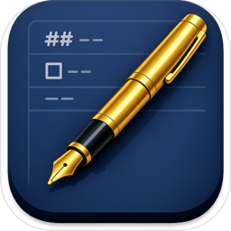</a>
      <b><a href="https://marknote.pages.dev/">MarkNote</a></b><br>
      <sub>Local-first WYSIWYG Markdown editor — Tauri, React, CodeMirror 6</sub>
    </td>
    <td valign="top" width="50%">
      <a href="https://apps.apple.com/app/wifidetect/id6823874308">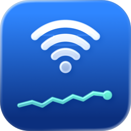</a>
      <b><a href="https://apps.apple.com/app/wifidetect/id6823874308">WiFiDetect</a></b><br>
      <sub>Wi-Fi signal, traffic and HTTP(S) debugging for macOS, with an iPhone &amp; iPad companion</sub>
    </td>
  </tr>
  <tr>
    <td valign="top" width="50%">
      <a href="https://github.com/linzeyan/assistant">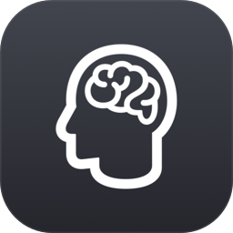</a>
      <b><a href="https://github.com/linzeyan/assistant">Assistant</a></b><br>
      <sub>Private, fully local AI assistant for Apple Silicon Macs</sub>
    </td>
    <td valign="top" width="50%">
      <a href="https://github.com/linzeyan/dbeaver">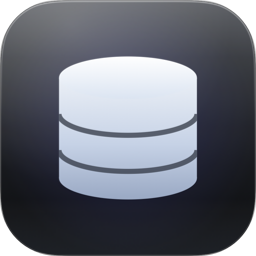</a>
      <b><a href="https://github.com/linzeyan/dbeaver">DbClient</a></b><br>
      <sub>Native DBeaver-class database client — Rust core, Metal grid, no JVM, ~35 databases</sub>
    </td>
  </tr>
  <tr>
    <td valign="top" width="50%">
      <a href="https://github.com/linzeyan/viewer">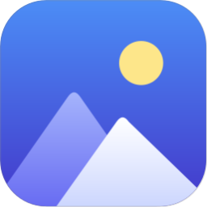</a>
      <b><a href="https://github.com/linzeyan/viewer">Viewer</a></b><br>
      <sub>Lightweight image viewer for macOS &amp; Windows — opens a 48 MP photo in ~75 MB of memory</sub>
    </td>
    <td valign="top" width="50%">
      <a href="https://github.com/linzeyan/FontsMaker">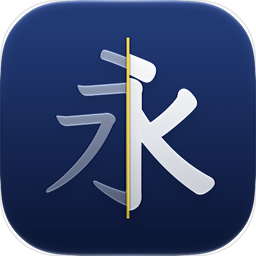</a>
      <b><a href="https://github.com/linzeyan/FontsMaker">FontsMaker</a></b><br>
      <sub>Turn open-source fonts into e-reader fonts — embolden, pseudo-vertical, simplified → traditional</sub>
    </td>
  </tr>
  <tr>
    <td valign="top" width="50%">
      <a href="https://github.com/linzeyan/InputMethodEditor">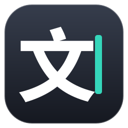</a>
      <b><a href="https://github.com/linzeyan/InputMethodEditor">InputMethodEditor</a></b><br>
      <sub>Windows Chinese IME (Zhuyin &amp; Pinyin) built on libchewing</sub>
    </td>
    <td valign="top" width="50%">
      <a href="https://github.com/linzeyan/macshot">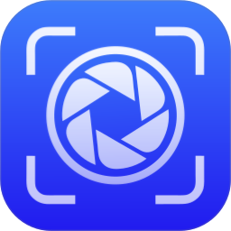</a>
      <b><a href="https://github.com/linzeyan/macshot">macshot for Windows</a></b><br>
      <sub>Windows port of <a href="https://macshot.io">macshot</a> — annotate, record, OCR + translate, scroll capture</sub>
    </td>
  </tr>
  <tr>
    <td valign="top" width="50%">
      <a href="https://github.com/linzeyan/LiteBrowser">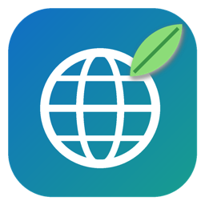</a>
      <b><a href="https://github.com/linzeyan/LiteBrowser">LiteBrowser</a></b><br>
      <sub>Tabbed browser for low-memory Windows / VDI — freezes idle tabs, Chrome extensions, built-in MCP server</sub>
    </td>
    <td valign="top" width="50%">
      <a href="https://github.com/linzeyan/testing">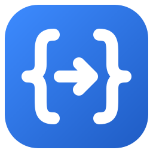</a>
      <b><a href="https://github.com/linzeyan/testing">apitool</a></b><br>
      <sub>Portable Postman-style API client — REST, GraphQL, WebSocket, gRPC, MQTT. Unzip and run</sub>
    </td>
  </tr>
</table>

> [!TIP]
> Most apps and CLIs install via Homebrew:
> ```sh
> brew tap linzeyan/tools
> brew install --cask <app>   # desktop apps
> brew install <cli>          # command-line tools
> ```

### Developer Tools

<table>
  <tr>
    <td valign="top" width="50%">
      <a href="https://github.com/linzeyan/vscode-syntax">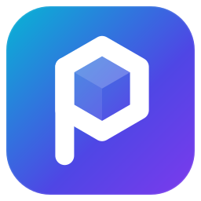</a>
      <b><a href="https://github.com/linzeyan/vscode-syntax">Poly</a></b><br>
      <sub>One CLI + one VSCode extension that replace a pile of per-language highlight / lint / format extensions</sub>
    </td>
    <td valign="top" width="50%">
      <a href="https://github.com/linzeyan/file-format-extension">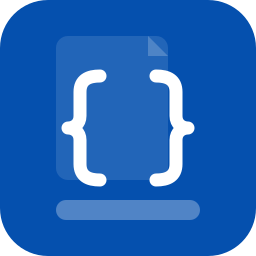</a>
      <b><a href="https://github.com/linzeyan/file-format-extension">file-format-viewer</a></b><br>
      <sub>Browser extension that pretty-prints and syntax-highlights raw data and config files</sub>
    </td>
  </tr>
  <tr>
    <td valign="top" width="50%">
      <a href="https://github.com/linzeyan/s3dal">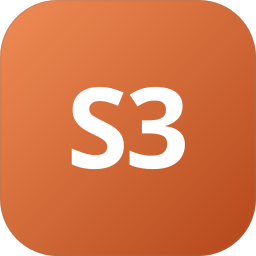</a>
      <b><a href="https://github.com/linzeyan/s3dal">s3dal</a></b><br>
      <sub>S3 API in front of a local directory, another S3, Azure Blob or GCS — one binary, or embed as a library</sub>
    </td>
    <td valign="top" width="50%">
      <a href="https://github.com/linzeyan/formatter">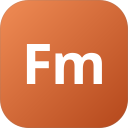</a>
      <b><a href="https://github.com/linzeyan/formatter">formatter</a></b><br>
      <sub>Multi-format file formatter CLI in pure Rust</sub>
    </td>
  </tr>
  <tr>
    <td valign="top" width="50%">
      <a href="https://github.com/linzeyan/redis-top-keys-analyzer"></a>
      <b><a href="https://github.com/linzeyan/redis-top-keys-analyzer">redis-top-keys-analyzer</a></b><br>
      <sub>Find the biggest and hottest keys in Redis</sub>
    </td>
    <td valign="top" width="50%">
      <a href="https://github.com/linzeyan/proxy-manager">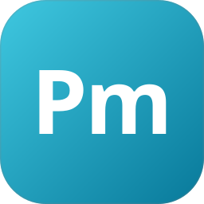</a>
      <b><a href="https://github.com/linzeyan/proxy-manager">pm</a></b><br>
      <sub>CLI for managing v2ray / sing-box / xray</sub>
    </td>
  </tr>
  <tr>
    <td valign="top" width="50%">
      <a href="https://github.com/linzeyan/nginx">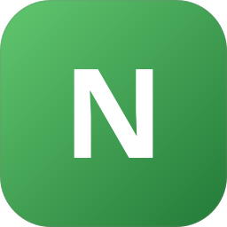</a>
      <b><a href="https://github.com/linzeyan/nginx">nginx</a></b><br>
      <sub>Auto-built, statically linked nginx / OpenResty <code>.deb</code> / <code>.rpm</code>, tracking upstream releases</sub>
    </td>
    <td valign="top" width="50%"></td>
  </tr>
</table>

### On the Web

<table>
  <tr>
    <td valign="top" width="50%">
      <a href="https://draft-4w0.pages.dev"></a>
      <b><a href="https://draft-4w0.pages.dev">draft</a></b><br>
      <sub>Paste a SQL schema, get an editable ER diagram — runs entirely in your browser</sub>
    </td>
    <td valign="top" width="50%">
      <a href="https://transforms.pages.dev">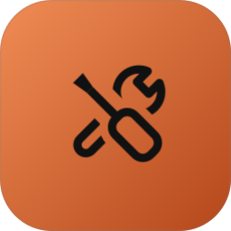</a>
      <b><a href="https://transforms.pages.dev">transform</a></b><br>
      <sub>Developer toolbox in Rust/WASM: UUID, JWT, hashes, JSON ⇄ YAML/TOML/XML, and more</sub>
    </td>
  </tr>
  <tr>
    <td valign="top" width="50%">
      <a href="https://keybr.pages.dev/"></a>
      <b><a href="https://keybr.pages.dev/">keybr 注音</a></b><br>
      <sub>Zhuyin (Bopomofo) typing trainer — a keybr.com fork that drills your weakest keys</sub>
    </td>
    <td valign="top" width="50%">
      <a href="https://scrolling-light.pages.dev">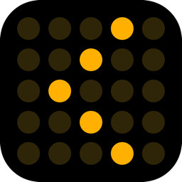</a>
      <b><a href="https://scrolling-light.pages.dev">SCROLLING.LIGHT</a></b><br>
      <sub>Full-screen LED marquee that lives entirely in the URL — offline, installable</sub>
    </td>
  </tr>
  <tr>
    <td valign="top" width="50%">
      <a href="https://papercutting.pages.dev">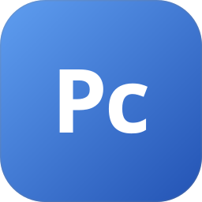</a>
      <b><a href="https://papercutting.pages.dev">PaperCut</a></b><br>
      <sub>Fold virtual paper, cut shapes, unfold to see the pattern, export as SVG</sub>
    </td>
    <td valign="top" width="50%">
      <a href="https://puzzle-coloring.pages.dev"></a>
      <b><a href="https://puzzle-coloring.pages.dev">Pintu</a></b><br>
      <sub>Turn any image into a coloring page or jigsaw puzzle</sub>
    </td>
  </tr>
  <tr>
    <td valign="top" width="50%">
      <a href="https://universal-ex.pages.dev"></a>
      <b><a href="https://universal-ex.pages.dev">Universe</a></b><br>
      <sub>Animated solar system &amp; Milky Way — rotation and orbits</sub>
    </td>
    <td valign="top" width="50%"></td>
  </tr>
</table>

### Libraries

<table>
  <tr>
    <td valign="top" width="50%">
      <a href="https://github.com/linzeyan/loadconf">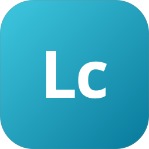</a>
      <b><a href="https://github.com/linzeyan/loadconf">loadconf</a></b><br>
      <sub>Go: declare a config struct, load it from files, environment variables and etcd</sub>
    </td>
    <td valign="top" width="50%">
      <a href="https://github.com/linzeyan/webp-go">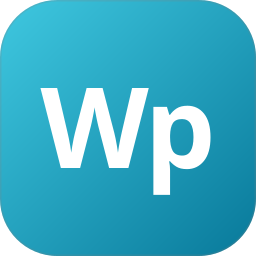</a>
      <b><a href="https://github.com/linzeyan/webp-go">webp-go</a></b><br>
      <sub>Pure-Go WebP encoder (lossy, lossless, animation, alpha), no cgo</sub>
    </td>
  </tr>
</table>

<details>
<summary><b>Earlier work</b></summary>
<br>

- [ops-cli](https://github.com/linzeyan/ops-cli) — A collection of useful tools for ops
- [block](https://github.com/linzeyan/block) — Block IPs manually or from Nginx logs
- [gpgen](https://github.com/linzeyan/gpgen) — Generate GraphQL or protobuf schema from model files
- [gd](https://github.com/linzeyan/gd) — Get DNS zones and records from AWS, Cloudflare, West
- [k8s_cluster](https://github.com/linzeyan/k8s_cluster) — Install a k8s cluster with just `vagrant up`

</details>

<br>

<picture>
  <source media="(prefers-color-scheme: dark)" srcset="./profile-3d-contrib/profile-night-rainbow.svg">
  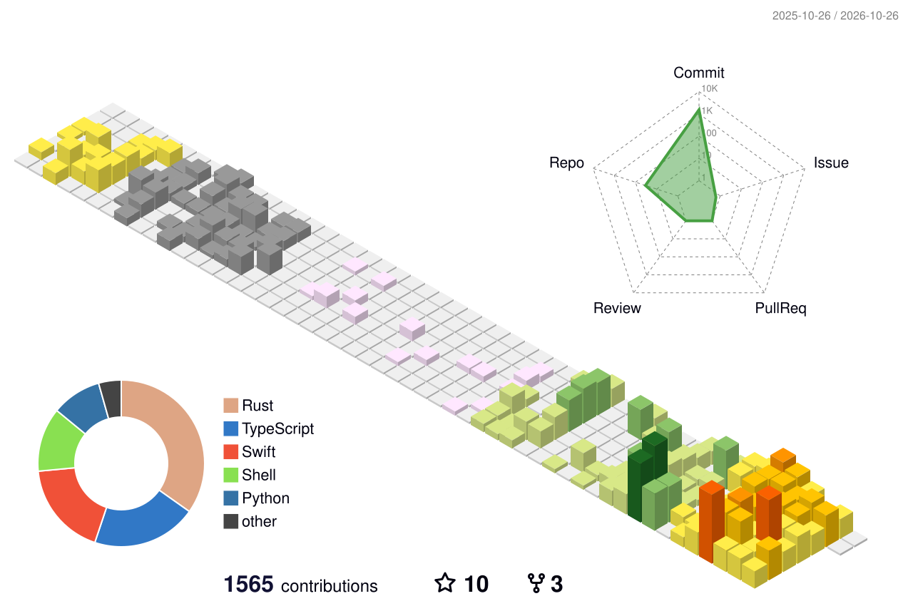
</picture>
